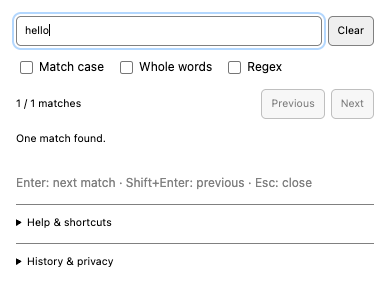

# Sigma Search

A local find-in-page extension with control over case, whole words and keyboard
navigation. Use plain text for everyday searches, with regular expressions available
when you need them.

**Beta scope:** visible text in the main HTTP/HTTPS document. Collapsed content,
image descriptions, iframes, shadow DOM and PDF text are not searched in this beta.
The planned result list will make room for content that cannot be highlighted;
that functionality is not part of this release.



## Features

- Literal/regex search, case sensitivity and Unicode whole words.
- Source-aware matches across inline markup and collapsed whitespace.
- Correct handling of restored CSS visibility and closed disclosure sections.
- Navigation inside nested scrollers and automatic refresh on page changes.
- Terminable pattern workers, cancellation and explicit partial-result warnings.
- Session-only drafts and optional local history; no application network requests or analytics.
- Activation through `activeTab`, with no permanent host permissions.

## Try it

The extension requires **Chrome/Chromium 116+**. There is no build step.

1. Open `chrome://extensions` and enable **Developer mode**.
2. Choose **Load unpacked** and select this repository's root directory.
3. Open an HTTP/HTTPS page and invoke Sigma Search from the extensions menu.
4. Type a word or phrase; results and options update automatically. Try **Match case**
   or **Whole words** to narrow the search. **Regex** is an optional advanced mode.

Use **Enter / Shift+Enter** or the arrow buttons for next/previous matches, and
**Escape** to close the popup. Navigation stops at the first/last match. The result
area stays visible; partial coverage is shown separately from a complete no-match result.
Global shortcuts default to **Alt+Shift+F** (open), **Alt+Shift+N** (next) and
**Alt+Shift+P** (previous). Resolve browser/OS conflicts at `chrome://extensions/shortcuts`.

After changing code, reload the extension and refresh pages running an earlier version.
Browser-internal pages and other browser-restricted origins cannot be searched.

## Development

Use **Node.js 24+**; `.nvmrc` selects Node 24.

```sh
nvm use
npm ci
npm run check
npm run test:browser
```

| Command                | Purpose                                                |
| ---------------------- | ------------------------------------------------------ |
| `npm run check`        | Formatting, ESLint and unit tests                      |
| `npm run format`       | Apply the shared Prettier configuration                |
| `npm run test:browser` | Real DOM regressions and installed-extension scenarios |

The browser suite uses a temporary Chrome profile and a local fixture server.
Set `CHROME_BIN` to override browser detection. Set `SIGMA_EXTENSION_PATH` to test
an extracted package instead of the working-tree runtime. It needs a recent Chrome supporting
CDP `Extensions.loadUnpacked` and `Extensions.triggerAction`. Set `SIGMA_SCREENSHOT`
to capture local light/dark PNGs of the popup. The normal browser profile is never used.

[GitHub Actions](.github/workflows/ci.yml) is configured to run both check commands
on pushes and pull requests. See [validation](docs/VALIDATION.md) for test boundaries
and the remaining manual release checks.
See [the beta handoff](docs/BETA.md) for the acceptance checklist and feedback template.

## Beta package

Run `npm run package` (requires Python 3) to produce
`dist/sigma-search-0.1.0-beta.zip`. The deterministic archive contains only the
manifest, runtime source, assets and license. Extract it to a new directory and
load that directory as an unpacked extension. `node_modules`, tests, editor files
and Git metadata are excluded.

## Engineering guide

The project uses native ES modules and browser APIs without runtime dependencies.
The popup, content engine and worker contexts have explicit responsibilities;
small injected adapters keep Chrome APIs outside the matching and storage-policy tests.

- [Architecture and decisions](docs/ARCHITECTURE.md): process boundaries, source mapping, cancellation and tradeoffs.
- [Validation and limitations](docs/VALIDATION.md): supported scope, limits, regression coverage and pilot checklist.
- Start reading at [the engine](src/content/search-engine.js), [the matcher](src/shared/matcher.js)
  or [the popup controller](src/popup/popup.js).

## Privacy

Page text is processed transiently by a local extension worker. Drafts use browser
session storage and are removed when a tab closes. History is **off by default**;
when enabled, up to 50 unique queries stay on the device. **Delete saved history**
removes those entries. Turning history off stops future additions without deleting
existing entries. Private-window queries are never added to history.

The `offscreen` permission provides the worker host; `storage` holds settings and
optional history. `activeTab` and `scripting` grant access when the user invokes
the extension. No backend or external account is required.

## License and attribution

[MIT](LICENSE). The project began with Fresh Chrome Extension boilerplate.
Icons: [Socket icons by Freepik — Flaticon](https://www.flaticon.com/free-icons/socket).
