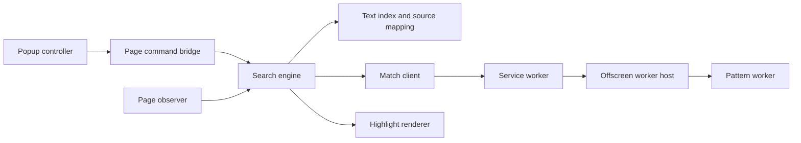

# Architecture

Sigma Search is a Manifest V3 extension with no build step or runtime packages.
Its complexity comes from browser process boundaries and DOM geometry, rather
than application infrastructure.

## Runtime flow

1. The popup obtains temporary page access through the browser action. It injects
   highlight CSS and a small classic content-script entry only when necessary.
2. The entry registers its message listener synchronously. Incoming commands await
   module loading, and repeated injection reuses one controller in the isolated world.
3. The engine collects searchable text with mappings back to its original nodes.
   Only strings and options cross the worker boundary; DOM nodes stay on the page.
4. The service worker creates/reuses the offscreen document, which owns terminable
   workers. Each worker returns UTF-16 match offsets, not rendered geometry.
5. The engine resolves offsets to live source ranges, filters unusable geometry,
   preserves the active source match where possible, and publishes a state snapshot.
6. The renderer updates native highlights and isolated control overlays. Navigation
   scrolls the source's actual ancestors, rather than an overlay outside that subtree.

## Responsibilities

| Module                          | Owns                                                          |
| ------------------------------- | ------------------------------------------------------------- |
| `content/content-script.js`     | Classic-script injection and asynchronous module bridge       |
| `content/page-controller.js`    | Command routing and runtime notification adapter              |
| `content/search-engine.js`      | Search lifecycle, authoritative page state and active match   |
| `content/text-index.js`         | Normalization and normalized-offset → source mapping          |
| `content/source-visibility.js`  | Rendered-source checks, including closed disclosure ancestors |
| `content/match-geometry.js`     | Source rectangles, clipping and navigation                    |
| `content/control-geometry.js`   | Approximate input/textarea/select measurement                 |
| `content/highlight-renderer.js` | Highlight registry and isolated overlay DOM                   |
| `content/page-observer.js`      | Page subscriptions and symmetric cleanup                      |
| `shared/matcher.js`             | Pure literal/regex matching                                   |
| `shared/constants.js`           | Message names, limits and storage-key conventions             |
| `background.js`                 | Offscreen startup, request routing, shortcuts and tab cleanup |
| `offscreen/worker-host.js`      | Worker lifetime, timeout and cancellation                     |
| `popup/popup.js`                | User actions and asynchronous request coordination            |
| `popup/popup-view.js`           | Cached DOM bindings and rendering                             |
| `popup/popup-storage.js`        | Serialized writes, draft migration and privacy policy         |

Paths in the table are relative to `src/`.

## State and cancellation

The page engine is authoritative for the executed query, results and active index.
The popup owns the editable draft and renders page snapshots. Reopening reads the
existing state instead of repeating the search or scrolling back to its first match.

Three separate counters solve different ordering problems:

- **Engine generation:** a superseded search cannot commit results.
- **Snapshot revision:** an older notification cannot overwrite newer rendered state.
- **Popup request version:** a reply for an edited draft cannot update the current UI.

An `AbortController` cancels obsolete work. Worker request IDs are scoped by tab in
the background router. The offscreen host settles a task only once and always
terminates its worker and releases its timer. A query timeout becomes explicit
feedback and is not retried automatically.

Mutation-driven refreshes coalesce. If a pass is already running, a pending refresh
waits for it to finish, so continuously changing pages do not starve every pass.
Extension-owned DOM is marked and excluded from observation. `dispose()` removes
subscriptions, pending refreshes and highlight resources.

## Text and geometry

Each normalized text segment records its normalized interval and original node
and UTF-16 offsets. Collapsed whitespace can span nodes, so its endpoint is tracked
separately. Binary lookup reconstructs a range without rescanning all earlier text
for every match. Disconnected or shortened source nodes invalidate a candidate.

Native CSS highlights follow their ranges as layout changes. Search is refreshed
separately because visual movement and semantic changes are different problems.
Native form controls do not expose equivalent text ranges, so their geometry uses
canvas measurement or a temporary mirror. All control adapters return rectangle
arrays; their approximations and limits are documented in validation.

## Decisions and tradeoffs

- **Native JavaScript modules:** direct loading keeps development close to the shipped
  code. A UI framework or bundler currently adds little value to this small popup.
- **Offscreen document plus worker:** MV3 service workers cannot host the required DOM
  context directly. The extra message hop allows expensive regex execution to be
  terminated without blocking the content page or depending on an open popup.
- **Constructor/factory injection:** the engine can receive a matcher/renderer, while
  storage and worker hosts receive narrow platform adapters. No general DI framework is needed.
- **Bounded work:** limits prefer an honest partial-result warning over pretending
  that a resource-constrained pass covered the whole page.
- **Minimal permissions:** a supported page is activated by the user. No persistent
  host grant is needed, at the cost of explicit activation after navigation.
- **JavaScript rather than a language migration:** JSDoc explains the complex source
  mapping and module contracts. TypeScript could be reconsidered if those contracts
  grow substantially; it is not required to introduce clear boundaries now.

## Beta visibility boundary

The beta indexes rendered main-document text. Visibility inheritance is evaluated
on text/control sources rather than pruning every `visibility:hidden` subtree,
since a child can explicitly restore visibility. Closed `
` is traversed
through its first summary only, before matching and resource accounting. Geometry
also checks source visibility because a rectangle alone does not establish that
text is painted, and a disclosure can close during an asynchronous search.

Hidden-content search and result snippets require a future source-result model
that can represent a match without highlight geometry. The beta deliberately does
not manufacture navigable matches from unpainted layout rectangles.
